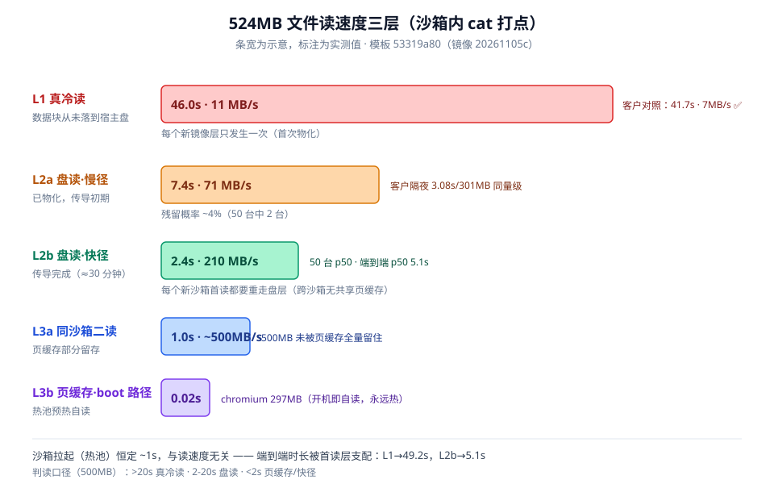
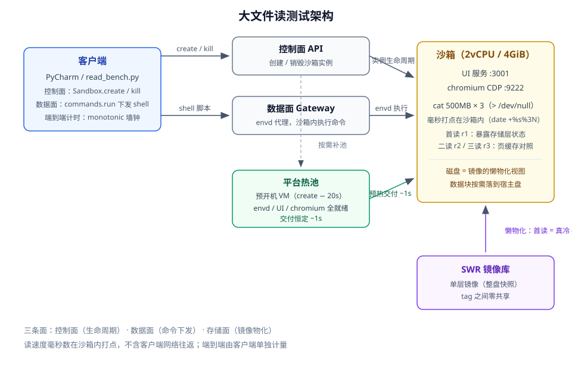
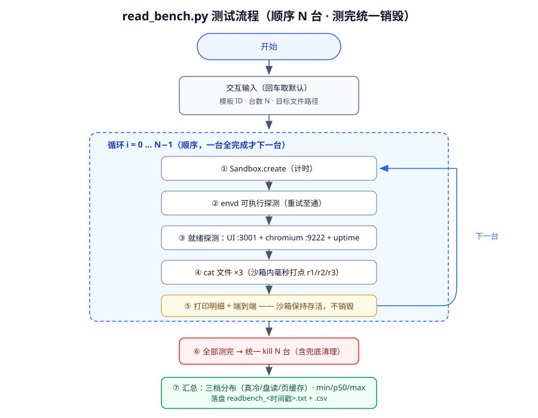

# 客户场景测试 —— 沙箱大文件读慢问题复现与量化

> 2026-11-05 ~ 11-06 · AgentSphere（华为云 E2B 兼容沙箱，cn-southwest-2）

## 背景

客户反馈：沙箱内**首次完整读取 301MB 的 chrome 二进制耗时 41.7 秒（仅 7MB/s）**，同一沙箱内第二、三次读取降到 0.06 秒；隔夜新建的沙箱首读同文件只要 3.08 秒（98MB/s），但读另一个从未碰过的文件（libgallium）仍需 6 秒。

本目录用 **500MB 纯数据文件 + 全新镜像 + 全新模板** 复现并量化了该现象，沉淀为可复用的测试脚本、测试方案与结论。

## 结论速览：读速度分三层

| 层 | 状态 | 500MB 实测 | 对应客户数据 |
|---|---|---|---|
| **L1 真冷读** | 镜像数据块从未落到宿主盘 | **46.0s（11MB/s）** | 41.7s（7MB/s）✅ 同层 |
| **L2 盘读** | 已物化，新沙箱首读 | 初始 7.4s（71MB/s）→ 约 30 分钟收敛 **2.4s（210MB/s）** | 隔夜 3.08s（98MB/s）✅ 同量级 |
| **L3 页缓存** | 开机路径文件（热池预热时已被读） | 297MB / **0.02s** | 0.06s ✅ 同层 |

关键事实：

- **沙箱拉起（热池交付）恒定 ~1s**，与读速度无关；"端到端"时长被首读支配（L1 时 49.2s，L2 时 5.1s）
- 只有**纯数据文件**（无任何进程触碰）能暴露 L1；开机路径文件（如浏览器二进制，每次开机自读）永远测不到 L1
- 跨沙箱无共享页缓存：L2 之后每个新沙箱首读都要重走盘层
- 单层镜像的 tag 之间零共享：每个新镜像的全量字节都要重新物化一遍



## 测试架构



客户端（PyCharm / read_bench.py）走两条面：**控制面**（API create/kill）、**数据面**（gateway 向沙箱内下发 shell）。读速度的毫秒级计时在**沙箱内部**打点（`date +%s%3N`），不含网络往返；端到端用客户端单调时钟单独计量。

## 场景与脚本索引

| 场景 | 脚本 | 测什么 | 输出 |
|---|---|---|---|
| S1 拉起耗时基准 | `scripts/spawn_bench.py` | create/envd/UI/chromium/端到端（交互输入模板+台数） | txt + csv |
| S2 大文件读对照·交互版 | `scripts/read_bench.py` | 首读/二读/三读 + 端到端 + 三档分布（**主交付**） | txt + csv |
| S2a 单文件快速对照 | `scripts/chromium_read_ab.py` | 同上精简版（环境变量传参，测完逐台销毁） | stdout |
| S2b 批量 50 台 | `scripts/bigfile_bench50.py` | 同 S2，测完统一销毁，看分布收敛 | txt |
| S3 镜像制作与推送 | `scripts/img_push3.py` + `scripts/img_pusher_inner.py` | 沙箱 rootfs → 单层 OCI → 直推 SWR | SWR 镜像 |



## 快速开始

```bash
# 1) 依赖：Python 3.10+，pip install e2b
# 2) 环境变量（控制台获取，一次性 setx 注入，勿写进代码/仓库）
setx E2B_API_URL  "<你的 AgentSphere API 地址>"
setx E2B_SANDBOX_URL "<你的沙箱网关地址>"
setx E2B_API_KEY  "<你的 key>"

# 3) 交互运行（输入模板 ID / 台数 / 文件路径）
python scripts/read_bench.py
```

判读口径（500MB 文件）：首读 >20s = 真冷读（L1）；2-20s = 盘读（L2）；<2s = 页缓存或快径（L3）。

## 目录结构

```
客户场景测试/
├── README.md                ← 本文件
├── docs/
│   ├── 01-客户问题与复现.md   ← 客户两张数据表 + 我们的三阶段复现时间线
│   ├── 02-平台机制发现.md     ← 热池 / 冷物化传导 / 页缓存 / A/B 实验
│   ├── 03-镜像制作与推送.md   ← rootfs→单层OCI→SWR 完整配方与坑
│   └── 04-脚本使用指南.md     ← 每个脚本的输入输出 + 环境变量说明
├── diagrams/                ← 测试架构图 / 三层读速度 / 流程图 / 镜像链路
├── scripts/                 ← 上述 6 个脚本（已脱敏，密钥走环境变量）
└── data/
    └── bench50_193436.txt   ← 50 台批量实测样例输出
```

## 脱敏说明

- 全部脚本中的 `E2B_API_KEY` / 网关地址 / SWR 临时凭据均已改为**环境变量注入**，仓库不含任何密钥字面量
- 客户侧标识（模板/快照 ID、镜像仓库名）一律未收录，仅保留现象数据
