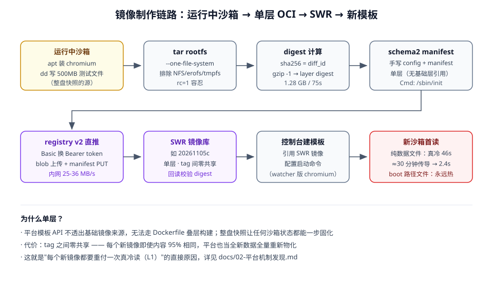

# 03 · 镜像制作与推送（rootfs → 单层 OCI → SWR）

## 1. 为什么用整盘快照法

- 平台模板 API 不透出基础镜像来源，无法走 Dockerfile 叠层构建
- 整盘快照法：**任何沙箱的当前状态都能一步固化成镜像**，不依赖拿不到的基础镜像



## 2. 配方（7 步，全部在沙箱内完成）

```
1) 沙箱内装好软件（apt install chromium fonts-liberation …）或 dd 写测试文件
2) tar -C / --numeric-owner --xattrs --acls --one-file-system \
       --exclude=./root/rootfs.tar --exclude=./root/rootfs.tar.gz \
       --exclude=./root/.swr_env -cpf /root/rootfs.tar .
3) sha256(rootfs.tar) = diff_id（未压缩层摘要）
4) gzip -1 压缩 → sha256 = layer digest
5) 手写 docker schema2 config + manifest（单层）
6) registry v2 API 直推：
   GET /swr/auth/v2/registry/auth/?service=dockyard&scope=repository:<repo>:pull,push
       （Basic 认证换 Bearer token）
   POST /v2/<repo>/blobs/uploads/ → 202 Location
   PUT  <Location>?digest=sha256:...   （流式传层）
   PUT  /v2/<repo>/manifests/<tag>
7) GET manifest 回读校验 digest
```

实测速率：沙箱→SWR 内网 25-36MB/s（1.28GB 层 50s）。

`--one-file-system` 自动排除 /mnt（NFS）、/opt/sandbox-runtime（erofs）、tmpfs 注入文件。

## 3. 单层设计取舍

| 得 | 失 |
|---|---|
| 不依赖基础镜像，沙箱任意状态可固化 | tag 间零共享，每个新镜像全量存储/全量物化 |
| 流程极简，一个 python 文件搞定 | 无叠层历史，无法回滚单层 |

## 4. 镜像与模板演进

| 镜像 tag | 内容 | 产出模板 |
|---|---|---|
| 20261105 | 0db87f02(pilotdeck) rootfs + chromium 156 + fonts | 2db37b22（并行版）→ f6c0b17f（**watcher 正典**） |
| 20261105b | f6c0b17f rootfs 重推（新字节，做冷读对照） | 9b8a6e9b（首读仍热 → 发现 boot 路径效应） |
| 20261105c | f6c0b17f rootfs + dd 500MB urandom | 53319a80（**复现真冷读 46s**） |

模板启动命令（watcher 版）见 [02-平台机制发现](02-平台机制发现.md) 第 5 节。

## 5. 踩坑清单

| 坑 | 规避 |
|---|---|
| tar 报 `./sys: file changed as we read it`（rc=1） | 正常现象，容忍 rc∈{0,1} |
| `pkill -f chromium` 杀掉自己的 shell（命令行含关键词自匹配） | 用 `pkill -f 'chromiu[m]'` 方括号写法 |
| SWR 临时登录凭据 24h 过期 | 推送前重新生成；凭据走环境变量，不进代码/日志 |
| `commands.run` 不传 user/cwd 时默认 /home/user 不存在 | 始终 `user="root", cwd="/root"` |
| 管道喂 stdin 有 BOM 前缀 | `input()` 后 `.strip().lstrip("")` |
| `python -I` 忽略 PYTHONIOENCODING | 加 `-X utf8` |

## 6. 配套脚本

- `scripts/img_pusher_inner.py`：沙箱内执行的全流程（tar→digest→gzip→manifest→推 SWR→校验），凭据读环境变量
- `scripts/img_push3.py`：本地编排示例（拉沙箱 → 注入 inner 与凭据 → dd 大文件 → 触发推送）
